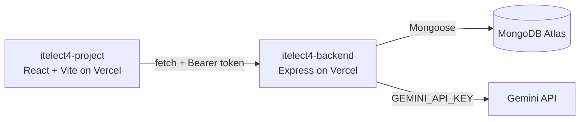

# itelect4-project

The frontend of the Event RSVP & Check-In System: React, Vite and TypeScript,
with Tailwind and shadcn/ui, React Router, Zustand, TanStack Query, React Hook
Form and Zod.

- **Live site:** https://itelect4-project-phi.vercel.app
- **Backend repo:** https://github.com/Rayz-bit/itelect4-backend
- **Live API:** https://itelect4-backend-brown.vercel.app/api/health

## What it does

Browse events, register and log in, RSVP to an event, see your RSVPs, and ask
the AI Review page for feedback on an event description.

## Architecture

The browser never talks to Gemini or MongoDB. Only the backend holds those keys.

## Run it locally

1. `npm install`
2. Create `.env.local` with `VITE_API_URL` set to the address where your backend
   runs (see `.env.example`), then `npm run dev`.
3. `npm test` runs the Vitest tests.

## AI use

I used an AI assistant (Claude) while building this project for explanations,
debugging and drafting code. I tested the result and can explain every file.
